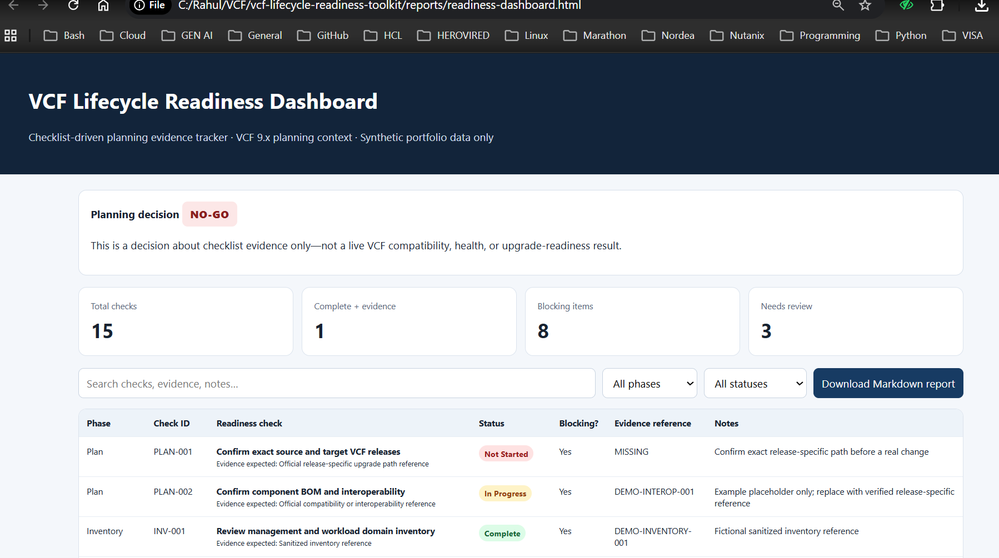
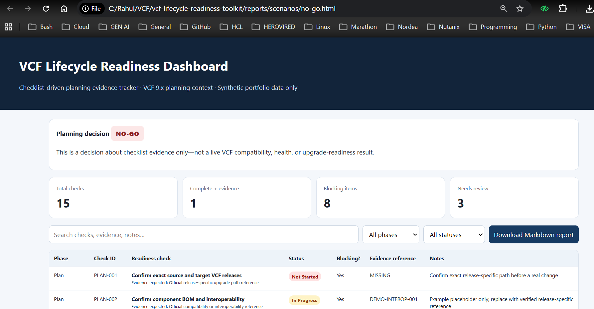
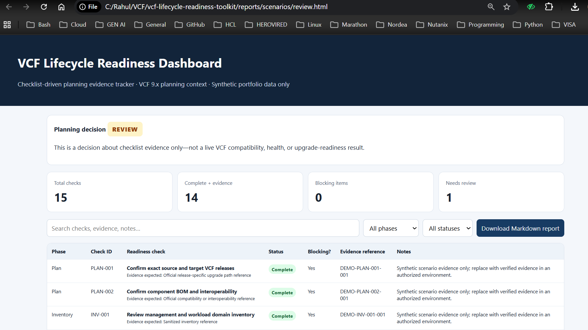
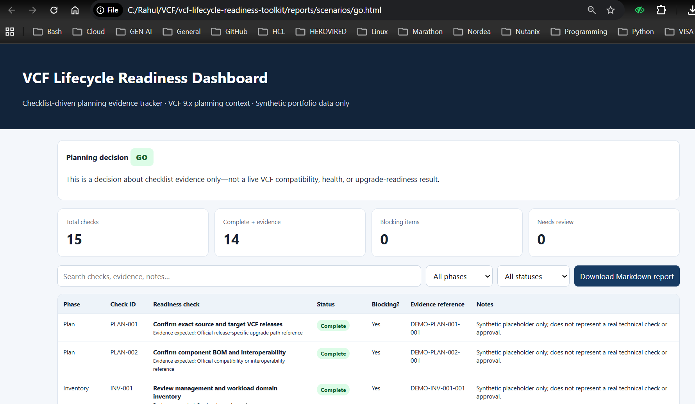

# VCF Lifecycle Readiness Toolkit (Portfolio Lab)

**Purpose:** A small Python toolkit for reviewing lifecycle-change planning evidence and producing a Markdown report, accompanied by a VCF 9.x-oriented planning guide and operational checklist.

> **Scope disclosure:** This is a self-directed documentation and simulation project using fictional data and training-derived planning topics. It is not a live VCF lab, a completed VCF 9.x upgrade, a vendor compatibility checker, or an upgrade automation tool. It does not connect to SDDC Manager, vCenter, NSX, ESXi, or Broadcom APIs.

## Dashboard preview

The screenshot below shows the standalone checklist dashboard using fictional portfolio data. The displayed `NO-GO` is an evidence-tracking result, not a live VCF validation.



### Decision scenarios

These screenshots show the three synthetic evidence-tracking outcomes. They are illustrative examples, not live VCF validation.

| NO-GO — blocking evidence gaps | REVIEW — non-blocking work remains |
|---|---|
|  |  |

**GO — checklist rules satisfied using synthetic placeholders**



## Scenario-based decision demonstration

Three synthetic status files demonstrate the decision logic: `data/scenarios/no-go.csv`, `data/scenarios/review.csv`, and `data/scenarios/go.csv`. Run all three on Windows, macOS, or Linux with `python scripts/run_scenarios.py`; output goes to `reports/scenarios/`. Read [Scenario Demonstration](docs/scenario-demonstration.md) before interpreting the example `GO` case. Every evidence reference in these scenarios is fictional and must not be treated as technical validation or change authorization.

## What it demonstrates

- JSON inventory structure validation
- Change-readiness evidence checks for ownership, maintenance window, backup/recovery evidence, health checks, compatibility references, rollback planning, and approval
- Markdown report generation
- Unit tests and GitHub Actions CI
- VCF lifecycle planning documentation based on sanitized learning notes and public Broadcom API references

## Run locally

Requires Python 3.10+; no third-party packages are required.

```bash
# Generate the inventory/change-evidence report
python src/vcf_readiness.py --input data/sample_environment.json --output reports/readiness-report.md

# Generate a standalone, filterable HTML checklist dashboard and Markdown report
python src/vcf_dashboard.py

# Run all automated tests
python -m unittest discover -s tests -v
```

Open `reports/readiness-dashboard.html` in a browser. The dashboard supports text search, phase/status filters, and downloading the Markdown report. Edit `data/checklist_status.csv` to track status and evidence references for each checklist ID; the checklist definition remains in `docs/vcf9-readiness-checklist.csv`.

### Dashboard decision rules

- **NO-GO:** a blocking check is `Not Started` or `Blocked`, or is marked `Complete` without an evidence reference.
- **GO:** every check is `Complete` with an evidence reference, or `Not Applicable` with a written rationale.
- **REVIEW:** no blocking condition applies, but one or more checks remain in progress or otherwise need review.

The sample status file intentionally includes gaps, so its sample dashboard should show `NO-GO`. This is expected for the synthetic example.

The status describes planning-evidence completeness only. `READY` does **not** mean an upgrade path is supported, a compatibility check passed, or the infrastructure is technically ready. Confirm exact source/target releases and the supported path in current official documentation before any real change.

## Project layout

- `data/sample_environment.json` — fictional example inventory
- `data/checklist_status.csv` — fictional progress/evidence state for checklist checks
- `data/scenarios/` — synthetic NO-GO, REVIEW, and GO decision-rule examples
- `scripts/run_scenarios.py` — cross-platform generation and validation of all three scenarios without changing the default status file
- `scripts/run-scenarios.ps1` — PowerShell wrapper for scenario generation
- `docs/images/scenario-no-go.png`, `scenario-review.png`, `scenario-go.png` — scenario screenshots used in this README
- `docs/images/dashboard-preview.png` — dashboard screenshot used in this README
- `docs/scenario-demonstration.md` — scenario instructions and limitations
- `src/vcf_dashboard.py` — CSV-driven dashboard and Markdown report generator
- `tests/test_vcf_dashboard.py` — dashboard decision-rule tests
- `src/vcf_readiness.py` — report generator
- `tests/` — unit tests
- `docs/vcf9-lifecycle-planning-guide.md` — VCF 9.x-oriented planning guide and checklist
- `docs/vcf9-readiness-checklist.csv` — reusable checklist template
- `docs/source-material-map.md` — traceability from training topics to original portfolio content
- `docs/architecture.md` — toolkit architecture and status semantics
- `docs/operational-runbook.md` — local run instructions
- `docs/dashboard-guide.md` — dashboard inputs, decision rules, and limitations
- `.github/workflows/tests.yml` — CI test workflow
- `reports/sample-readiness-report.md` — generated sample report

## How training material was used

The local learning presentation identified in the working notes is titled **“VMware vSphere 8 to 9 Upgrade Project.”** Its topics include compatibility/HCL, backups, health/capacity checks, vSphere Lifecycle Manager, cluster validation, rollback planning, CAB approval, maintenance windows, and stakeholder roles. These have been rewritten as generic planning prompts. The presentation is vSphere-focused and does not prove a supported VCF 9.x upgrade path; the guide explicitly separates those concepts from VCF-specific release validation.

Do not publish course PDFs, certification records, proprietary screenshots, employer data, credentials, internal hostnames, tokens, or other restricted material without permission. Use fictional examples or sanitize evidence.

## Official references

- [VCF API Reference](https://developer.broadcom.com/xapis/vmware-cloud-foundation-api/latest/)
- [VCF Upgrades APIs](https://developer.broadcom.com/xapis/vmware-cloud-foundation-api/latest/upgrades/)
- [VCF System Prechecks APIs](https://developer.broadcom.com/xapis/vmware-cloud-foundation-api/latest/system-prechecks/index.html)
- [VCF API Specifications](https://developer.broadcom.com/sdks/vcf-api-specification/latest)

API endpoints and behaviour can change. The official API documentation notes that older system-precheck endpoints are deprecated in favour of newer lifecycle check-set endpoints where applicable; verify the current API for the exact deployed release before designing an integration.

## Future enhancements

1. Add mocked API-response examples to teach task/status interpretation without credentials.
2. Consider a separate read-only integration against an authorized lab, with least-privilege access, TLS verification, secret handling, release-specific API checks, and explicit tests.
3. Never add upgrade execution or production integration without a proper lab and a separately reviewed safety design.
