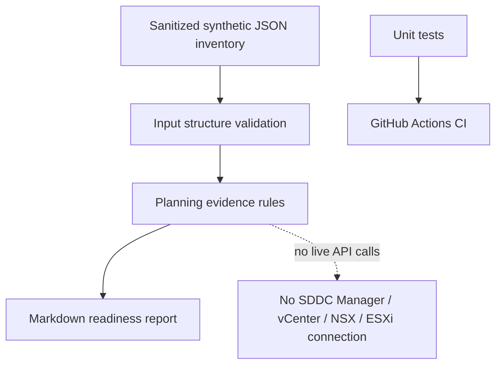

# Architecture

The toolkit is a local, offline planning-evidence report generator. It does not integrate with a VCF API or query a live infrastructure environment.

## Status semantics

- `BLOCKED`: owner or rollback plan is missing.
- `REVIEW`: evidence is missing or change approval is not in an accepted approved state.
- `READY`: the basic planning fields are populated and approval text is accepted. This is not technical readiness or vendor compatibility confirmation.

## Future extension boundary

A future read-only integration could query a lab using the current, release-specific VCF APIs and authorized credentials. That should be a separate feature with explicit authentication, least-privilege access, TLS verification, safe secret handling, API version checks, and tests using mocked responses. No such integration is included now.

## Checklist dashboard flow

`docs/vcf9-readiness-checklist.csv` defines the check catalogue. `data/checklist_status.csv` stores synthetic per-check progress and evidence references. `src/vcf_dashboard.py` validates and joins these CSVs, applies explicit planning-evidence decision rules, and emits a standalone `reports/readiness-dashboard.html` plus a Markdown report. The browser dashboard is static/self-contained; it does not make network calls or connect to VMware APIs. See `docs/dashboard-guide.md` for schema and semantics.

## Conceptual VCF architecture diagram

See [the original conceptual diagram](images/vcf-conceptual-architecture.svg). It shows a simplified management domain, workload/VI domains, lifecycle orchestration, and cross-domain dependencies. Component placement and availability are design- and release-dependent; use current official guidance for a real deployment. The readiness toolkit is shown separately because it does not connect to live infrastructure.
