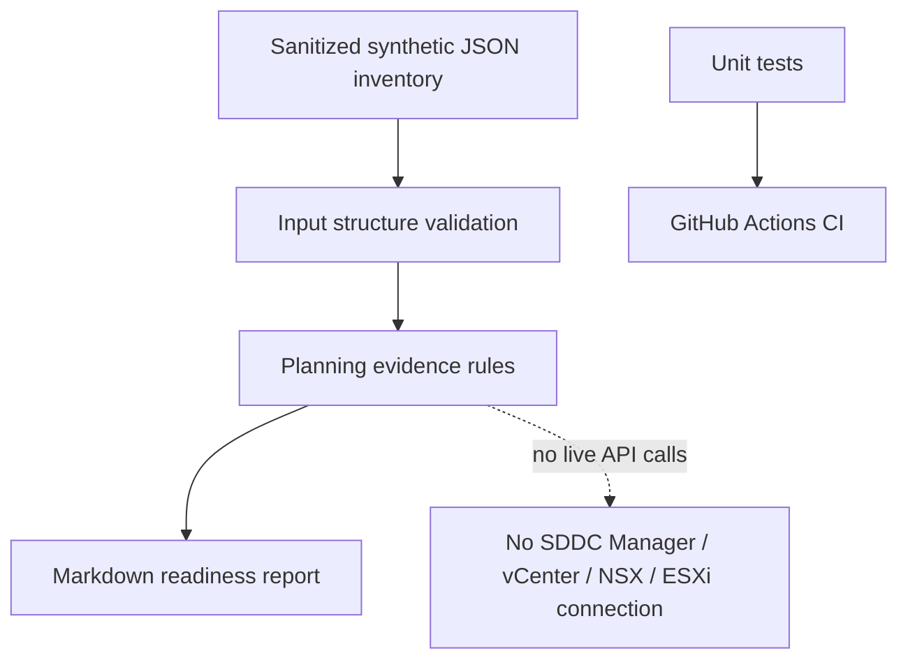

# Architecture

The toolkit is a local, offline planning-evidence report generator. It does not integrate with a VCF API or query a live infrastructure environment.

## Status semantics

- `BLOCKED`: owner or rollback plan is missing.
- `REVIEW`: evidence is missing or change approval is not in an accepted approved state.
- `READY`: the basic planning fields are populated and approval text is accepted. This is not technical readiness or vendor compatibility confirmation.

## Future extension boundary

A future read-only integration could query a lab using the current, release-specific VCF APIs and authorized credentials. That should be a separate feature with explicit authentication, least-privilege access, TLS verification, safe secret handling, API version checks, and tests using mocked responses. No such integration is included now.
